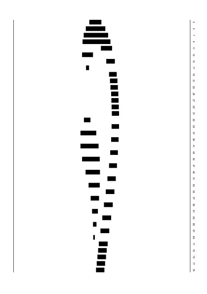

# tBookFold 📖✨

A simple Python tool to convert black-and-white images into custom **book folding patterns**.
<br>


## 🚀 Getting Started

### Prerequisites

Install the required Python packages using `pip`:

```bash
pip install -r requirements.txt
```

### Usage

Import and run the `create` function from `bookfold.py` to generate your pattern:

```python
from bookfold import create

create("examples/ornament.jpg", 3, 477, 190)
```

## 📂 Examples

Check out the `examples/` folder for a sample input image, the corresponding Python script, and the generated PDF pattern.

<table>
  <tr>
    <th width="50%">Original Image</th>
    <th width="50%">Generated Fold Pattern (Page 1)</th>
  </tr>
  <tr>
    <td align="center">
      
    </td>
    <td align="center">
      
    </td>
  </tr>
</table>
